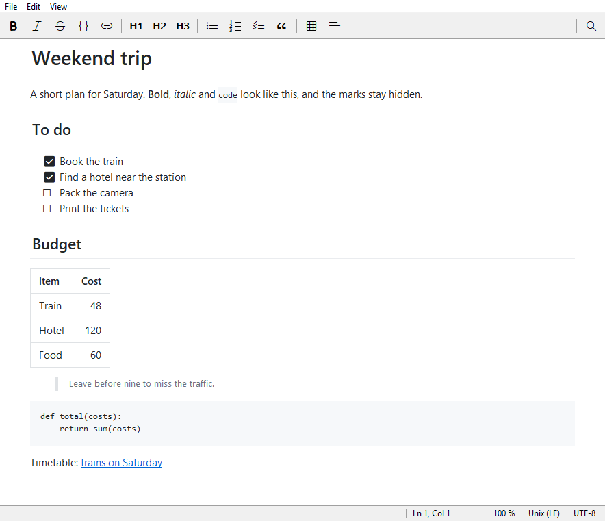
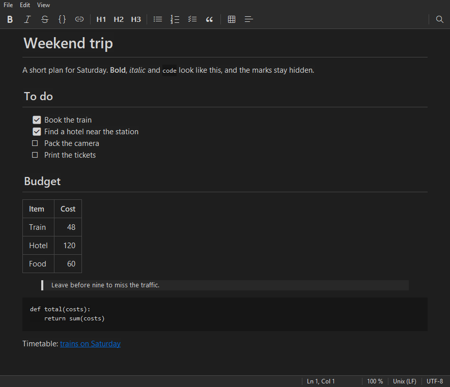
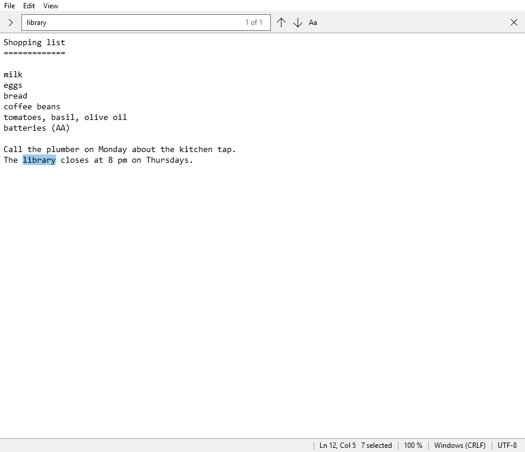

# Bloc

Un bloc de notas pequeño para Windows 10 y 11, con Markdown en vivo. Un solo `.exe` de unos 2 MB, escrito en Rust sobre
el control RichEdit de Windows.

[Read in English](README.md)

## Qué hace

- Los archivos de texto guardan su codificación y sus saltos de línea al guardar.
- Los `.md` se ven con formato mientras escribes (títulos, listas, casillas, citas, enlaces, código y tablas), con una
  barra de formato y las marcas ocultas. Ctrl+Mayús+M las enseña.
- Las tablas de Markdown se dibujan como rejilla, con la cabecera en negrita. Se insertan desde la barra y se alinean
  con Ctrl+Mayús+T.
- Modo claro y oscuro, también uno en cada ventana a la vez.
- Buscar y reemplazar, imprimir, elegir la letra, la codificación y los saltos, y el corrector de Windows.
- «Seguir luego» al cerrar: el texto se queda como nota y vuelve la próxima vez.
- Vista previa de los archivos de texto y Markdown en el panel de vista previa del Explorador.
- La interfaz va en el idioma de Windows: español, inglés, francés, alemán, italiano, portugués, ruso, polaco, turco,
  chino, japonés y coreano (en inglés para el resto).







## Frente a otros editores

| | Bloc | Bloc de notas (Windows 11) | Notepad++ |
|---|---|---|---|
| Markdown con formato mientras escribes | Sí | Sí | No, solo colores |
| Tablas de Markdown dibujadas como rejilla | Sí | Sí | No |
| Funciona en Windows 10 | Sí | No, la versión con Markdown es solo de Windows 11 | Sí |
| `.md` con formato en el panel de vista previa del Explorador | Sí | No | No |
| Un solo archivo, se instala sin permisos de administrador | Sí | Viene con Windows | Instalador o zip |
| Código abierto | Sí, MIT | No | Sí, GPL |

El Bloc de notas se comprobó el 26 de noviembre de 2026 con la versión 11.2609.11.0. Notepad++, por su documentación.

Lo que mide Bloc, en un PC de oficina con Windows 11:

| | |
|---|---|
| Desde que se abre hasta que se ve un `.txt` | 83 ms |
| Desde que se abre hasta que se ve un `.md` | 98 ms |
| Memoria con un archivo abierto | 3,6 MB |
| Memoria tras 10.000 cambios | 4,4 MB |
| Tamaño de `Bloc.exe` | 1,9 MB |

## Instalar

Descarga `Bloc.exe` de la última versión y ábrelo. Se instala solo para tu usuario, sin pedir permisos de administrador:

- se copia en `%LOCALAPPDATA%\Programs\Bloc`;
- se pone en el menú Inicio, en «Abrir con» y en Aplicaciones instaladas, desde donde se desinstala;
- pregunta qué tipos de archivo abrir con Bloc y cuáles enseñar en la vista previa.

El `.exe` no lleva un certificado de pago, así que SmartScreen avisa la primera vez. Antes de abrirlo, comprueba que su
SHA-256 es el de las notas de la versión.

Para comprobarlo desde PowerShell:

```powershell
Get-FileHash .\Bloc.exe -Algorithm SHA256
```

## Atajos

| Teclas | Qué hacen |
|---|---|
| Ctrl+N, Ctrl+O, Ctrl+S | Nuevo, abrir, guardar |
| Ctrl+F, Ctrl+H | Buscar, reemplazar |
| Ctrl+B, Ctrl+I, Ctrl+K | Negrita, cursiva, enlace (en los `.md`) |
| Ctrl+1, Ctrl+2, Ctrl+3 | Título 1, 2, 3 (en los `.md`) |
| Ctrl+Mayús+T | Alinear tablas |
| Ctrl+Mayús+M | Ver las marcas de formato |
| Ctrl+Mayús+D | Modo noche |
| Alt+Z | Ajuste de línea |
| Ctrl++, Ctrl+-, Ctrl+0 | Acercar, alejar, zoom normal |

## Compilar

Hace falta Rust estable con el destino `x86_64-pc-windows-gnu`. La única dependencia es `windows-sys`.

```powershell
.\construir.ps1
```

Pasa las pruebas, compila y pone el icono, el manifiesto y la versión en `target\Bloc.exe`. El último paso firma la
actualización con la clave privada del proyecto, que no está en el repositorio: sin ella el guion se para ahí, y el
`.exe` funciona, pero un Bloc instalado no lo acepta como actualización.

`Bloc.exe /fuentes <carpeta>` saca el código que lleva dentro cada `.exe`.

## Privacidad

Bloc no recoge ni envía nada. Más en [PRIVACY.md](PRIVACY.md) (en inglés).

## Informar de un problema

Archivo › Informar de un fallo, o una incidencia nueva en este repositorio. Los problemas de seguridad, como dice
[SECURITY.md](SECURITY.md).

## Licencia

[MIT](LICENSE)
