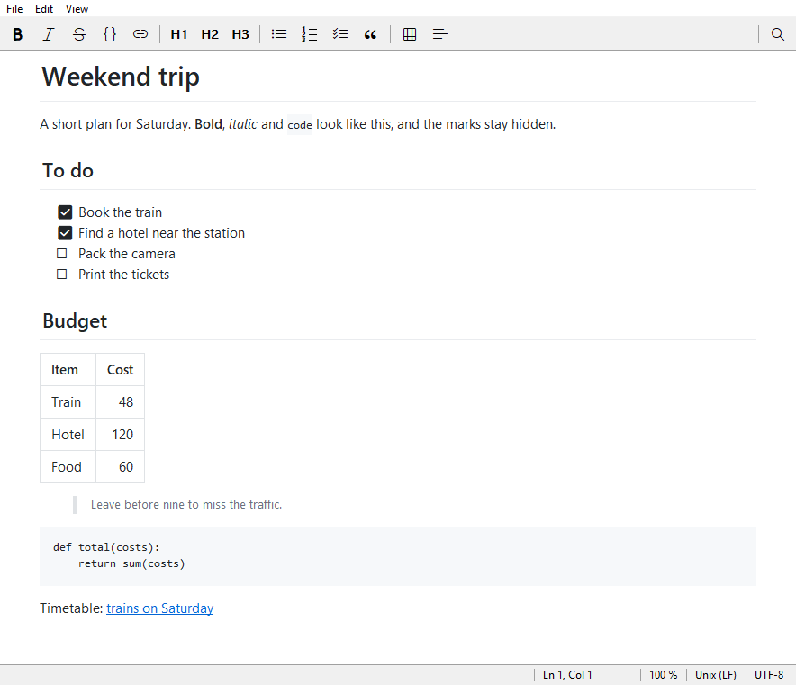
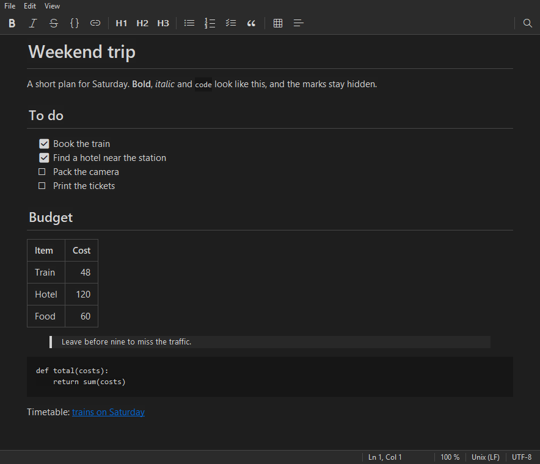
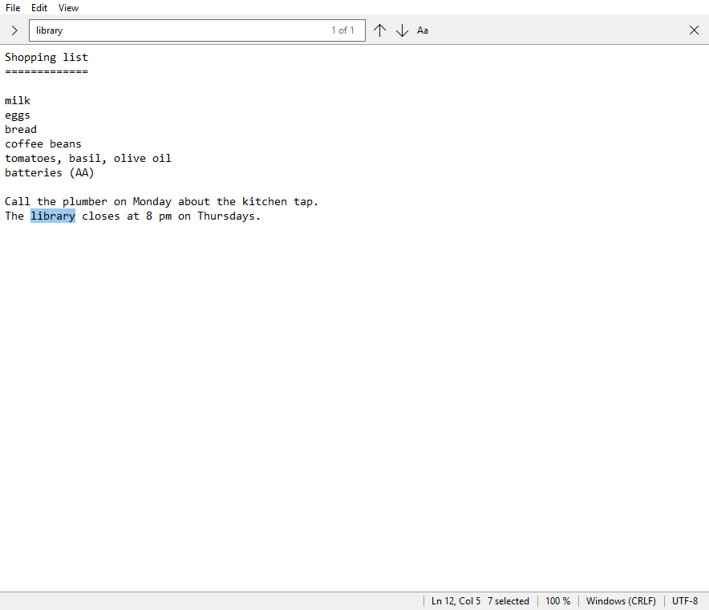
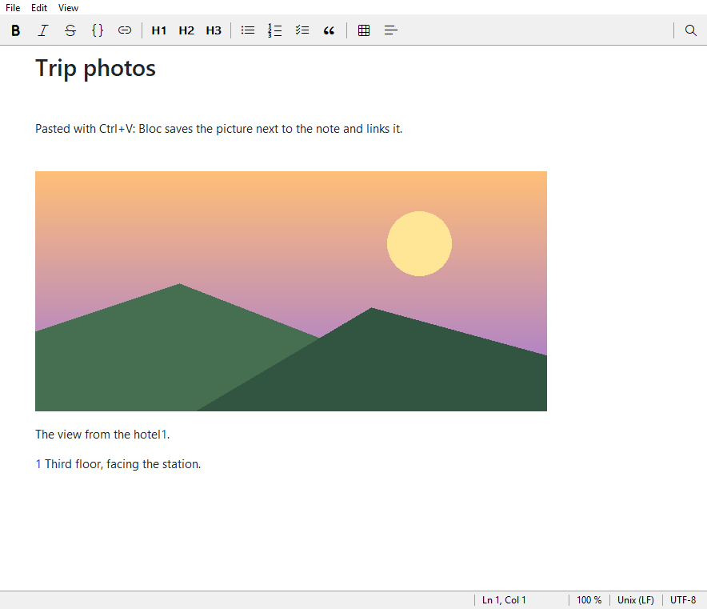

# Bloc

A small notepad for Windows 10 and 11, with live Markdown. One `.exe` of about 2 MB, written in Rust on top of the
Windows RichEdit control.

[Leer en español](README.es.md)

## What it does

- Plain text files keep their encoding and line endings when you save.
- `.md` files are formatted as you type (headings, lists, checklists, quotes, links, code and tables), with a
  formatting bar and the marks hidden. Ctrl+Shift+M shows them.
- Markdown tables are drawn as a grid with a bold header. Insert them from the bar and align them with Ctrl+Shift+T.
- A screenshot pasted with Ctrl+V into a `.md` is saved as a PNG next to the note and linked; images from the folder
  show under their line. Files copied in File Explorer paste as links.
- Light and dark mode, also one of each at the same time in two windows; a new window can open in the opposite color.
- Fits in a small window: the title bar, the button bar and the status bar step aside when there is no room.
- Find and replace, print, choose the font, the encoding and the line endings, Windows spell checker.
- "Keep for later" when you close: the text stays as a note and comes back next time.
- Preview of text and Markdown files in the File Explorer preview pane.
- The interface follows the Windows language: Spanish, English, French, German, Italian, Portuguese, Russian, Polish,
  Turkish, Chinese, Japanese and Korean (English for the rest).









## Compared with other editors

| | Bloc | Notepad (Windows 11) | Notepad++ |
|---|---|---|---|
| Markdown shown with formatting as you type | Yes | Yes | No, highlighting only |
| Markdown tables drawn as a grid | Yes | Yes | No |
| Runs on Windows 10 | Yes | No, the Markdown version is Windows 11 only | Yes |
| Formatted `.md` in the File Explorer preview pane | Yes | No | No |
| One file, installs without administrator rights | Yes | Comes with Windows | Installer or zip |
| Open source | Yes, MIT | No | Yes, GPL |

Notepad was checked on 26 November 2026 with version 11.2609.11.0. Notepad++ from its own documentation.

Bloc's own numbers, measured on an office PC with Windows 11:

| | |
|---|---|
| From launch until a `.txt` is on screen | 83 ms |
| From launch until a `.md` is on screen | 98 ms |
| Memory with a file open | 3.6 MB |
| Memory after 10,000 edits | 4.4 MB |
| Size of `Bloc.exe` | 1.9 MB |

## Install

Download `Bloc.exe` from the latest release and open it. It installs itself for your user only, without asking for
administrator rights:

- it copies itself to `%LOCALAPPDATA%\Programs\Bloc`;
- it adds itself to the Start menu, to "Open with" and to Installed apps, where you can uninstall it;
- it asks which file types to open with Bloc and which ones to show in the preview pane.

The `.exe` isn't signed with a paid certificate, so Windows SmartScreen will warn you the first time. Check the SHA-256
in the release notes before you open it.

To check it from PowerShell:

```powershell
Get-FileHash .\Bloc.exe -Algorithm SHA256
```

## Shortcuts

| Keys | What they do |
|---|---|
| Ctrl+N, Ctrl+O, Ctrl+S | New, open, save |
| Ctrl+F, Ctrl+H | Find, replace |
| Ctrl+B, Ctrl+I, Ctrl+K | Bold, italic, link (in `.md`) |
| Ctrl+1, Ctrl+2, Ctrl+3 | Heading 1, 2, 3 (in `.md`) |
| Ctrl+Shift+T | Align tables |
| Ctrl+Shift+M | Show formatting marks |
| Ctrl+Shift+D | Dark mode |
| Alt+Z | Word wrap |
| Ctrl++, Ctrl+-, Ctrl+0 | Zoom in, zoom out, default zoom |

## Build from source

You need stable Rust with the `x86_64-pc-windows-gnu` target. The only dependency is `windows-sys`.

```powershell
.\construir.ps1
```

It runs the tests, builds the program and puts the icon, the manifest and the version in `target\Bloc.exe`. The last
step signs the update with the project's private key, which isn't in this repository: without it the script stops
there, and the `.exe` works but won't be accepted as an update by an installed Bloc.

`Bloc.exe /fuentes <folder>` writes out the source code that each `.exe` carries inside.

The code comments are in Spanish.

## Privacy

Bloc doesn't collect or send anything. See [PRIVACY.md](PRIVACY.md).

## Reporting a problem

File › Report a problem, or a new issue in this repository. Security problems: see [SECURITY.md](SECURITY.md).

## License

[MIT](LICENSE)
